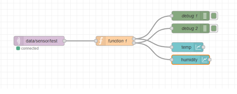
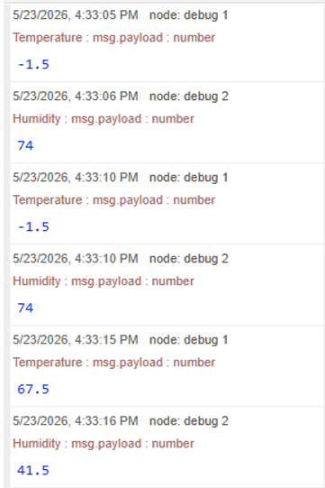
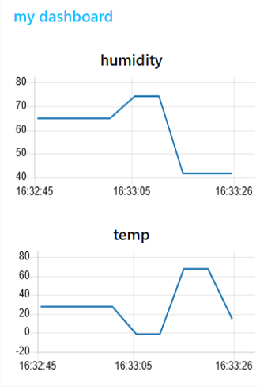

# ESP32 DHT22 MQTT Node-RED Dashboard

A simple IoT homework project that reads temperature and humidity from a **DHT22 sensor** using an **ESP32**, publishes the data through **MQTT**, and visualizes the output in a **Node-RED dashboard**.

This project was built to practice the basic workflow of an IoT system:

```text
Sensor → ESP32 → WiFi → MQTT Broker → Node-RED → Dashboard
```

## Project Overview

The ESP32 is connected to a DHT22 temperature and humidity sensor. The sensor data pin is connected to **GPIO4**, while the sensor power pins are connected to **3.3V** and **GND**.

The ESP32 connects to WiFi and then connects to an MQTT broker running on the computer. Every 5 seconds, it reads the temperature and humidity values from the DHT22 sensor, combines them into one comma-separated payload, and publishes the payload to an MQTT topic.

Node-RED subscribes to the MQTT topic, receives the sensor data, splits the temperature and humidity values, sends them to separate outputs, and displays them using debug nodes and dashboard charts.

## Features

- ESP32-based IoT sensor node
- DHT22 temperature and humidity reading
- WiFi connection from ESP32
- MQTT publish communication
- Random MQTT client ID generation to avoid client ID conflicts
- Sensor data publishing every 5 seconds
- Comma-separated payload format for easy parsing
- Node-RED MQTT subscriber flow
- Node-RED function node for splitting temperature and humidity
- Debug output for checking received values
- Dashboard charts for visualizing sensor data
- Velxio simulation/project file included

## Hardware / Tools Used

| Item | Purpose |
|---|---|
| ESP32 | Main IoT microcontroller board |
| DHT22 | Temperature and humidity sensor |
| GPIO4 | DHT22 data pin |
| WiFi | Network connection for ESP32 |
| MQTT Broker | Receives published ESP32 data |
| Node-RED | Processes and visualizes MQTT data |
| Velxio | ESP32 and DHT22 circuit/project environment |

## Circuit Connection

| DHT22 Pin | ESP32 Connection |
|---|---|
| VCC | 3.3V |
| GND | GND |
| DATA / SDA | GPIO4 |

## MQTT Configuration

The ESP32 publishes data to this topic:

```text
data/sensor/test
```

The Node-RED MQTT input subscribes to:

```text
data/sensor/+
```

This allows Node-RED to receive data from `data/sensor/test` and also supports other sensor IDs in the future.

The MQTT broker port used in the project is:

```text
1884
```

## Payload Format

The ESP32 sends temperature and humidity in one string, separated by a comma:

```text
temperature,humidity
```

Example:

```text
28.0,65.0
```

In Node-RED, the function node splits this payload:

```javascript
let parts = msg.topic.split("/");
let deviceId = parts[2];

let data = msg.payload.split(",");

let temperature = parseFloat(data[0]);
let humidity = parseFloat(data[1]);

let msgTemp = {
    topic: deviceId,
    payload: temperature
};

let msgHum = {
    topic: deviceId,
    payload: humidity
};

return [msgTemp, msgHum];
```

## ESP32 Firmware Logic

1. Start serial communication at `115200` baud.
2. Initialize the DHT22 sensor.
3. Connect the ESP32 to WiFi using SSID and password.
4. Configure the MQTT broker address and port.
5. Reconnect to MQTT if the connection is lost.
6. Every 5 seconds:
   - Read humidity from DHT22.
   - Read temperature from DHT22.
   - Check if the sensor values are valid.
   - Create a payload in `temperature,humidity` format.
   - Publish the payload to MQTT.
7. Node-RED receives, separates, debugs, and charts the values.

## Important Files

| File / Folder | Description |
|---|---|
| `firmware/esp32_dht22_mqtt.ino` | ESP32 Arduino firmware |
| `code/esp32-dht22.vlx` | Velxio project file |
| `node-red/flows.json` | Node-RED exported flow |
| `docs/images/node-red-flow.png` | Screenshot of the Node-RED flow |
| `docs/images/debug-output.png` | Screenshot of received MQTT debug data |
| `docs/images/dashboard.png` | Screenshot of Node-RED dashboard charts |

## How to Run

### 1. Prepare the MQTT Broker

Run an MQTT broker on your computer, for example Mosquitto, and make sure it is listening on the configured port:

```text
1884
```

### 2. Configure the ESP32 Code

Open `firmware/esp32_dht22_mqtt.ino` and update these values:

```cpp
const char* ssid = "YOUR_WIFI_NAME";
const char* password = "YOUR_WIFI_PASSWORD";
const char* mqtt_server = "192.168.x.x";
const int mqtt_port = 1884;
const char* mqtt_topic = "data/sensor/test";
```

Use your WiFi name, WiFi password, and the IP address of the computer running the MQTT broker.

### 3. Upload the Code to ESP32

Use Arduino IDE or another ESP32-compatible environment. Required libraries:

```text
WiFi.h
PubSubClient.h
DHT.h
```

Install these libraries if they are not already available.

### 4. Import the Node-RED Flow

Open Node-RED and import:

```text
node-red/flows.json
```

Then check that the MQTT broker settings match your local setup.

### 5. View the Dashboard

Open the Node-RED dashboard in your browser:

```text
http://localhost:1880/ui
```

You should see temperature and humidity charts updating as data is received.

## Screenshots

### Node-RED Flow



### Debug Output



### Dashboard



## What I Learned

- How to connect an ESP32 to WiFi
- How to read data from a DHT22 sensor
- How MQTT publish/subscribe communication works
- How to send sensor data from an embedded device to a broker
- How to process MQTT messages in Node-RED
- How to split and route sensor data into separate temperature and humidity outputs
- How to visualize IoT sensor data using dashboard charts

## Possible Improvements

- Send data as JSON instead of comma-separated text
- Add multiple sensors using different MQTT topics
- Add MQTT authentication
- Add error handling for broker disconnection
- Store data in a database
- Add alerts when temperature or humidity passes a threshold
- Deploy the Node-RED dashboard on a server or Raspberry Pi
